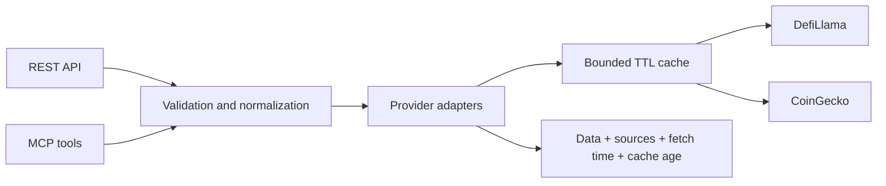

# DeFi Analyst v1

**Public DeFi data with its sources, dates and limitations attached.**

A Python service for exploring protocol TVL, fees, revenue, token markets and
category peers through a REST API or six MCP tools. It preserves unknown
values, reports data gaps and exposes the age of cached responses.

[Quick start](#quick-start) · [Offline example](#offline-example) ·
[API reference](#rest-api) · [Methodology](docs/data-methodology.md) ·
[MIT license](LICENSE)

## What it does

| Research question | Tool | What the answer includes |
|---|---|---|
| Which protocol does this name refer to? | search_protocol | Slug, category, chains and token identifier |
| How much capital does the provider report? | get_protocol_metrics | Latest valid TVL, observation date and scope warning |
| How has TVL changed? | get_historical_tvl | One observation per UTC date, gaps and partial-day status |
| How much are users paying and the protocol retaining? | get_fees_revenue | Separate fees/revenue, provider totals and methodology |
| What is the token's market context? | get_token_market_data | Price, market cap, FDV, volume and supply |
| Which projects share its category? | compare_peers | TVL-ranked candidates and explicit comparability limits |

Protocol slugs and CoinGecko coin IDs are different identifiers. Search first;
use gecko_id when available to resolve the token.

## How it works



REST and MCP share the same route logic. Provider adapters handle short-lived
caching, concurrent duplicate requests and bounded retries. Data normalization
keeps financial concepts separate; it does not produce investment ratings.

## Quick start

Requires Python 3.11 or later.

```sh
python3 -m venv .venv
source .venv/bin/activate
python -m pip install -r requirements.txt
cp .env.example .env
set -a; source .env; set +a
uvicorn app.main:app --reload
```

Set COINGECKO_DEMO_API_KEY in .env if you have a Demo key.
The application reads process environment variables; it does not automatically
load .env. Keep API keys out of Git.

Open [interactive API documentation](http://127.0.0.1:8000/docs).

## Example research workflow

**Question:** “Find Aave, inspect its reported TVL and compare category peers.”

1. Call search_protocol with query “aave”.
2. Use the returned slug with get_protocol_metrics.
3. Call compare_peers with that slug.
4. Read source dates, cache age and comparison warnings before interpreting
   the ranking. Category membership alone does not establish comparability.

Equivalent REST requests against your local server:

```sh
curl "http://127.0.0.1:8000/v1/protocols/search?q=aave&limit=5"
curl "http://127.0.0.1:8000/v1/protocols/aave/metrics"
curl "http://127.0.0.1:8000/v1/protocols/aave/peers?limit=5"
```

These commands contact live providers through the running service.
Returned numbers depend on provider coverage and fetch time.

## Offline example

A runnable demonstration uses an explicitly synthetic fixture and makes no
external HTTP requests:

```sh
python -m pip install -r requirements-dev.txt
python -m scripts.demo
```

Abbreviated output:

```json
{
  "example_only": true,
  "notice": "Synthetic fixture, not current or historical market data",
  "response": {
    "data": {
      "slug": "example-lending",
      "name": "Example Lending",
      "tvl_usd": 1200000,
      "tvl_date": "2025-06-15"
    }
  }
}
```

The full output also includes the requested source URL, actual local fetch
time, cache metadata and scope warnings. The sample URL identifies the
mocked request; it is not evidence that the fictional protocol exists.

## REST API

| Route | Purpose |
|---|---|
| GET /health | Process status and application version; no upstream request |
| GET /v1/protocols/search?q=aave | Resolve protocol names and slugs |
| GET /v1/protocols/{slug}/metrics | Latest valid reported TVL and metadata |
| GET /v1/protocols/{slug}/tvl?days=90 | Daily TVL and coverage |
| GET /v1/protocols/{slug}/fees-revenue?days=90 | Separate fee/revenue summaries and history |
| GET /v1/tokens/{coin_id}/market?vs_currency=usd | CoinGecko market data |
| GET /v1/protocols/{slug}/peers?limit=5 | Same-category research candidates |

History accepts days from 1 to 3650. By default, both history routes return
completed UTC days: a request for two days ends yesterday and starts the day
before. Add include_current_day=true to include today's incomplete observation
within the same number of calendar dates.

Duplicate dates use the latest timestamp, with last occurrence breaking ties.
They are never added together. Invalid rows are counted, missing dates are
reported and missing values remain null.

## Understanding a response

Successful REST responses and MCP tool results contain data and meta.

| Field | Meaning |
|---|---|
| data.window | Explicit UTC history period and partial-day flag |
| data.coverage | Observation count, missing dates and discarded-row counts |
| meta.retrieved_at | Oldest actual fetch time among contributing sources |
| meta.served_at | Time this response envelope was assembled |
| meta.source_fetches | Per-source retrieval time, cache hit, age and TTL |
| meta.sources | Requested public source URLs |
| meta.warnings | Data gaps and interpretation limits |

Source observation dates such as tvl_date and last_updated are separate from
fetch time. Cache hits retain their original fetch time.

Provider-reported 24h, 7d and 30d totals retain the provider's rolling-window
definitions. They are not recomputed from the completed-day history.
Always inspect summary_window and provider_methodology.

## Reliability

- Per-process LRU cache: up to 128 entries per provider.
- TTLs: protocol list 300 seconds; protocol/fee data 60 seconds; token markets
  30 seconds. Expired data is not silently served after failures.
- Identical concurrent misses share one upstream fetch.
- At most three GET attempts for transient connection failures, timeouts,
  rate limits and selected upstream server errors.
- Two-second maximum retry wait and a 20-second total budget per source.
  Longer Retry-After delays are propagated instead of ignored.
- Errors and invalid JSON are not cached.

REST errors retain an error object with code, message and provider.
Validation returns 422, missing resources 404, timeouts 504, upstream rate or
access limits 503, and other upstream failures 502. Retry-After is forwarded
when available. MCP tool errors set isError and include the HTTP status and
REST error envelope in their text.

The cache is local to each process, resets on restart and does not replace
authentication or per-user quotas.

## ChatGPT / MCP

The configured public deployment uses a stateless Streamable HTTP endpoint:

```text
https://defi-analyst-v1.onrender.com/mcp/
```

For local use, start the server and connect to:

```text
http://127.0.0.1:8000/mcp/
```

MCP tools use the same sources and limits as REST. TVL and fee/revenue tools
accept include_current_day=false by default. The public endpoint's availability
and deployed version depend on Render; check /health rather than assuming
the latest GitHub commit is already running.

## Tests

```sh
python -m pip install -r requirements-dev.txt
python -m pytest -q
```

Tests cover REST and MCP behavior, calendar boundaries, duplicate dates,
non-finite values, partial data, malformed responses, cache expiry and
provenance, concurrent requests, retry budgets and provider failures.
Live upstream transport is disabled during tests.

[GitHub Actions](https://github.com/Amexover/DeFi-Analyst-v1/actions) runs the suite
and offline demo on Python 3.11, 3.12, 3.13 and 3.14 after pushes to main and
pull requests. A configured workflow is not itself proof that a run passed.

## Deploy on Render

Connect the repository as a Render Blueprint using [render.yaml](render.yaml).
Review the selected plan and set COINGECKO_DEMO_API_KEY as a secret if needed.
No live credentials are committed.

The Free plan can spin down while idle and introduce a cold-start delay.
Its filesystem and in-memory cache are ephemeral. Check
[Render's current Free-plan limits](https://render.com/docs/free) before use.

## Interpretation limits

**TVL ≠ borrowed capital ≠ fees ≠ retained revenue ≠ net income ≠ buybacks.**

Peer ranking uses provider categories and TVL. It does not reconcile
parent/child overlap, bridged collateral, vault balances, reserve yield,
revenue distributions or token value accrual. The response marks this with
coverage_verified=false and a list of unadjusted factors.

Provider methodology is returned when available, not reconstructed.
For example, a series labelled “Perps” can include stablecoin reserve income.
The service does not independently verify accounting scope or promise
complete history.

See [data methodology](docs/data-methodology.md) and [CHANGELOG](CHANGELOG.md)
for exact rules and the history-window compatibility change in version 1.1.0.

## Project layout

| Path | Contents |
|---|---|
| app/main.py | REST routes and shared response semantics |
| app/mcp_server.py | Six MCP tools |
| app/providers.py | Provider requests, cache and retry handling |
| app/normalization.py | Finite numbers and daily UTC observations |
| app/provenance.py | Request-scoped source and cache metadata |
| tests/ | Offline regression tests |
| scripts/demo.py | Executable synthetic example |
| docs/data-methodology.md | Accounting, dates and comparability rules |

## License and attribution

Original software and software documentation are licensed under the
[MIT License](LICENSE), copyright © 2026 Philipp Lebedev.

DefiLlama and CoinGecko retain their rights in upstream data.
[DATA_LICENSE.md](DATA_LICENSE.md) describes attribution and reuse boundaries.
